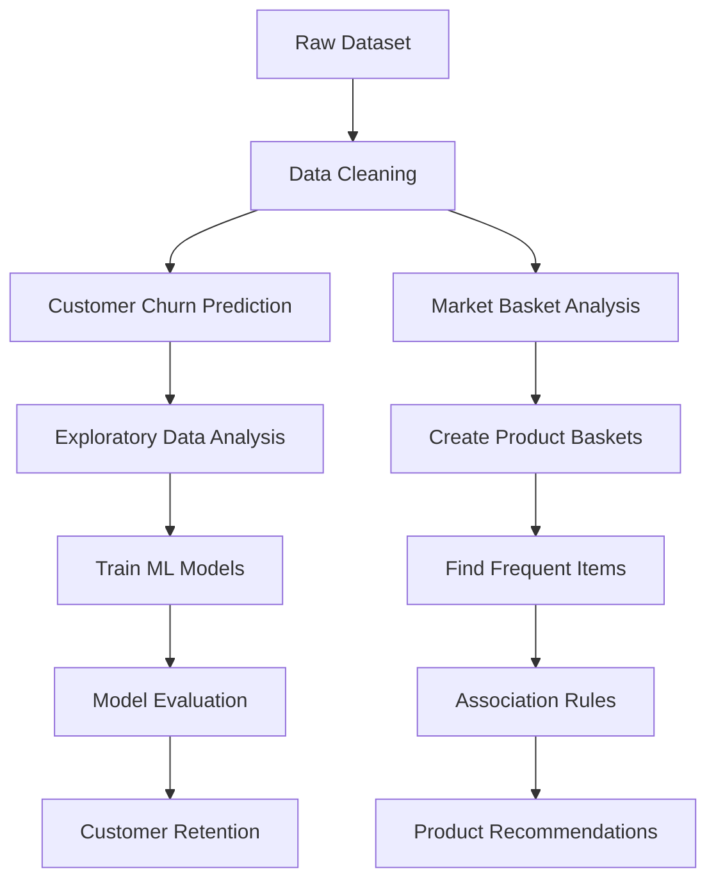

# Data Science & AI/ML Internship Projects

> Two Projects | One README | Practical Data Analysis and Machine Learning

This repository contains two internship projects:
1. Customer Churn Prediction
2. Market Basket Analysis

---

## 🧭 Project Overview

| Project | Goal | Techniques |
|---|---|---|
| Customer Churn Prediction | Identify customers who may leave a telecom service | EDA, Data Preprocessing, Logistic Regression, Random Forest |
| Market Basket Analysis | Discover products frequently purchased together | Data Cleaning, Frequent Itemsets, Association Rules, Support, Confidence, Lift |

---

## 🔄 Project Workflow



---

# 📊 Project 01: Customer Churn Prediction

### Objective
To predict which telecom customers are likely to leave the company using machine learning techniques.

### What the Project Does
- Explores customer churn patterns.
- Performs data cleaning and preprocessing.
- Uses an 80/20 train-test split.
- Applies Logistic Regression and Random Forest.
- Compares machine learning models.
- Evaluates models using Accuracy, Precision, Recall and ROC-AUC.

### Key Findings

Dataset contains 7,043 customers, of whom 1,869 churned.

| Model | Accuracy | Recall | Precision | ROC-AUC |
|---|---:|---:|---:|---:|
| Majority Baseline | 73.5% | 0% | 0% | 0.500 |
| Logistic Regression | 80.6% | 55.9% | 65.7% | 0.842 |
| Random Forest | 79.6% | 49.7% | 65.0% | 0.837 |

### Important Insights
- Month-to-month contracts show higher churn.
- Two-year contracts show lower churn.
- Logistic Regression achieved the best overall reported test metrics.
- The model can help identify customers who may need retention support.

### Dataset
IBM Telco Customer Churn Sample Dataset.

---

# 🛒 Project 02: Market Basket Analysis

### Objective
To identify products that are frequently purchased together using Market Basket Analysis.

### What the Project Does
- Loads and explores retail transaction data.
- Performs data cleaning.
- Removes cancelled transactions and administrative product lines.
- Creates product baskets using invoice numbers.
- Identifies frequently purchased product combinations.
- Generates association rules.
- Calculates Support, Confidence and Lift.

### Key Findings

| Measure | Result |
|---|---:|
| Eligible Invoices | 17,901 |
| Distinct Product Codes | 3,785 |
| Frequent Products | 827 |
| Frequent Product Pairs | 1,041 |
| Association Rules | 838 |

### Important Insights
- Jumbo Bag Pink Polkadot and Jumbo Bag Red Retrospot appeared together in 785 baskets.
- Herb Marker Parsley → Herb Marker Chives showed 82% confidence.
- Association rules help identify relationships between products.

### Business Applications
- Product recommendations.
- Cross-selling strategies.
- Product placement.
- Bundle offers.
- Improving customer shopping experience.

### Dataset
UCI Online Retail Dataset.

---

# 🧰 Tools & Technologies

- Python
- Jupyter Notebook
- Pandas
- NumPy
- Matplotlib
- Scikit-learn
- Machine Learning
- Data Visualization
- Association Rule Mining

---

# ▶️ How to Run the Projects

### 1. Customer Churn Prediction

```bash
cd "Customer Churn Prediction"
python -m pip install -r requirements.txt
jupyter lab Customer_Churn_Prediction.ipynb
```

### 2. Market Basket Analysis

```bash
cd "Market Basket Analysis"
python -m pip install -r requirements.txt
jupyter lab Market_Basket_Analysis.ipynb
```

Open the notebook and select Run All Cells to execute the analysis.

---

# ⚠️ Limitations

### Customer Churn Prediction
- Results are based on a sample dataset.
- Model performance may change with new customer data.
- Further testing is required before real-world deployment.

### Market Basket Analysis
- Results represent historical purchase patterns.
- Association does not prove that buying one product causes another purchase.
- Seasonal trends and product availability can affect results.

---

# 🎯 Conclusion

These two internship projects demonstrate practical applications of Data Science and Artificial Intelligence.

**Customer Churn Prediction** focuses on predictive analytics and machine learning to identify customers who may leave.

**Market Basket Analysis** focuses on discovering purchasing patterns and relationships between products.

Together, these projects demonstrate skills in data preprocessing, exploratory data analysis, machine learning, data visualization and analytical problem-solving.

---

**Internship Domain:** Data Science & Artificial Intelligence / Machine Learning
